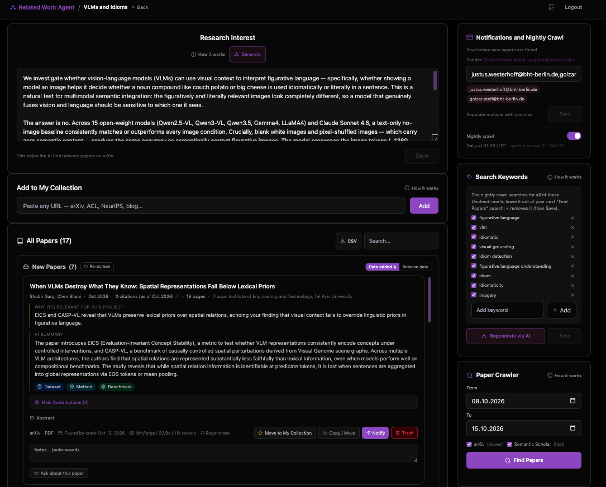
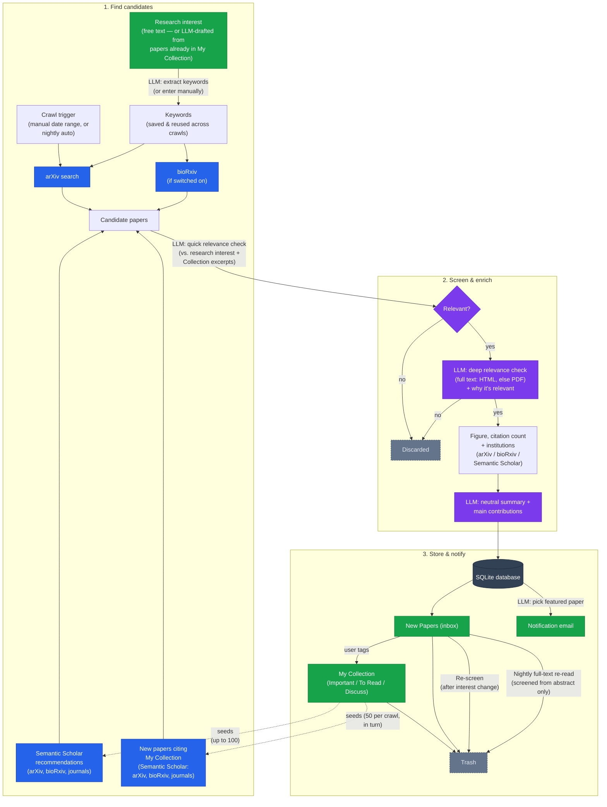

# Related Work Agent



A free, open-source, self-hosted **literature review assistant**. It tracks multiple research projects at once — each with its own research interest, keywords, and nightly crawl schedule — crawling arXiv and Semantic Scholar (and bioRxiv, if you switch it on), screening candidates with an LLM, and surfacing **everything you need to judge a paper in seconds**: a brief AI summary, figure 1, a direct PDF link, citation count, author affiliations, and a chat that has read the whole paper for whatever the summary doesn't answer. New papers land in an always-up-to-date database and get emailed to you, so keeping up with your field stays fun instead of overwhelming — even with how much gets published these days.

All it needs to run is any LLM that speaks the standard chat-completions API — that can be a small locally-hosted model just as well as a large one; we've only tested at the scale described below, but nothing about the tool requires it.

## Why this exists

I built this initially only for myself to solve a pressing real problem: staying on top of a fast-moving subfield without spending an hour a day on arXiv, without getting too biased by LinkedIn hype trains, and — just as often — to onboard fast onto a new topic when I only had one or two papers as leads.

Personally, we'd gotten curious about LLM anatomy after reading dnhkng's [Rys post](https://dnhkng.github.io/posts/rys/). A few weeks of automated crawling later, our instance of this agent surfaced [arXiv:2606.06574](https://arxiv.org/abs/2606.06574) — a paper we probably wouldn't have found by manually searching, given how little visibility it had (few stars on its GitHub repo, for example). That paper turned into a real research thread, which led to our own work, [RE-PoLar](https://datexis.github.io/RE-PoLar/).

## Our setup

We've been running this in production at Berliner Hochschule für Technik (BHT) (thanks, [RIS](https://labor.bht-berlin.de/ris)!) against a real self-hosted LLM since ~mid-2026, handling multiple concurrent research projects with nightly automated crawls. Concretely, here's what we actually run:

- **Model**: a quantized [MiniMax M2.7](https://huggingface.co/cyankiwi/MiniMax-M2.7-AWQ-4bit) deployment, self-hosted on one DGX node (8× A100, 40GB each) via vLLM.
- **App deployment**: Kubernetes (single-replica Deployment + CronJob sharing one SQLite database on a PVC), Docker image built from the included `Dockerfile`.

None of that is required to run this tool — see [Quick start](#quick-start) below for pointing it at any endpoint that speaks the same standard API (a self-hosted vLLM/Ollama/llama.cpp server, or a completely different setup entirely).

## How it works



The dashed edges are a feedback loop: papers you've already curated into My Collection seed Semantic Scholar's recommendations, and they are also checked for new papers that cite them (up to 50 per crawl, the ones checked longest ago first, so a larger collection is covered in turn over a few nights). The recommendations are asked for in groups of 10 seed papers (up to 100, best-tagged first): Semantic Scholar returns at most 500 per request, ranked by similarity over the last few months rather than by date, so a single request has only a few papers from the last days among them; each smaller group gets its own 500, and together they reach many more recent papers. A Collection paper that is not on arXiv seeds both by its DOI (or, without one, a Semantic Scholar title match), and both sources keep bioRxiv preprints and journal papers, not only arXiv ones: with biology or chemistry papers in the Collection most of what they find is published in journals. A journal paper is judged on its abstract unless its PDF is openly available from a site on the open-access list. A citing paper isn't necessarily relevant (widely cited papers are cited by work from every corner of the field), so these candidates go through the same screening as the rest. Collection papers also quietly inform two LLM steps not drawn above — keyword extraction and relevance screening both get calibration excerpts from your Collection too — so **the tool gets better targeted the more you curate**.

Each paper card shows a neutral AI summary (shared by every project the paper is in) and, per project, a short **"Why it's relevant"** line that the deep relevance check writes against that project's research interest. A paper that fits a different project can be **copied or moved** into that project's My Collection from its card. After you change the research interest, **Re-screen** in New Papers re-checks the papers still waiting there and moves the ones that no longer fit to Trash, where you can restore them.

Next to "AI Summary" each card says what the summary was made from: the paper's full text, or **"⚠ from abstract only"** when no full text could be fetched (hover for why). Regenerate tries the full text again.

**Ask about a paper.** Every card has an "Ask about this paper" chat. The model reads the paper's full text (arXiv's or bioRxiv's HTML version, else the PDF; the chat says "⚠ Abstract only" when neither is available) together with the project's research interest, and answers in markdown with rendered math. The chat is saved with the paper, per project like the notes, and visible to everyone on the project; Copy / Move takes it along. Answers stream in as they are written (the model's thinking is never shown, stored, or sent back), keep going if you close the page, and can be stopped. Questions sent while an answer is coming are queued. The header shows how much of the model's context window the conversation fills; when it is full you clear the chat rather than have old turns silently dropped. Each question re-sends the paper, but the LLM server's prefix cache usually makes follow-up questions start answering within a second.

Each card also says how the paper got into the project: found by a crawl, added by hand, or copied / moved from another project. For a crawl find it says which way, and lists all of them when there were several: the keyword it matched, a Semantic Scholar recommendation, or the My Collection paper it cites (e.g. *Found via keyword "sparse attention" · cites "Attention Is All You Need" (+2)*). arXiv is searched with all keywords at once, so the keyword is looked up in the title and abstract afterwards; when arXiv matched a word variant that isn't there literally, the card just says "arXiv keyword search". Hovering the line spells it out, one sentence per way (e.g. *It cites "Attention Is All You Need" from My Collection.*).

New Papers shows one card at a time: step through them with the ‹ / › buttons, the arrow keys or a swipe on a phone. Collecting or trashing a paper brings up the next one in its place.

The crawl email lists each source with how many papers it found and how many of those were added (e.g. *Papers citing My Collection: 60 (5 added)*), so over a few nights you can see which source brings the relevant papers. A paper found several ways counts in each of its rows, so the rows add up to more than the total, but it is screened only once.

A paper you add by URL fills in its card while you watch: it shows what is being fetched ("Fetching the figure", "Writing the AI summary…") and redraws itself as the details arrive, no reload needed.

A paper that is already in the project (New Papers, My Collection or Trash) is never added again. Papers the agent rejected are remembered too and skipped without another LLM call, as long as the research interest and My Collection stay the same; change either and earlier rejects get checked again.

You can also add any paper directly by pasting its URL. A bioRxiv link becomes the same paper a bioRxiv crawl would store (full text, figure 1, institution, citations). It first tries to resolve the paper to its arXiv version — an explicit arXiv link on the page, a DOI match, or (as a last resort) a title search on arXiv itself — and if found, treats it as a regular arXiv paper with full enrichment. If no arXiv version exists, the landing page's title/abstract/authors are still read regardless of domain, but the actual PDF (used for page count and author-institution extraction) is only downloaded from a small allowlist of open-access hosts — arXiv, ACL Anthology, PMLR, OpenReview, NeurIPS Proceedings, CVF (CVPR/ICCV/ECCV), AAAI, IJCAI, JMLR — out of respect for publisher licensing terms. For anything else, you still get the metadata, just not a downloaded PDF.

Every LLM step is a plain prompt template in [`app/prompts.py`](app/prompts.py). For example, the relevance check that filters candidate papers:

```
Evaluate if this paper is relevant for the research project.

Research interest:
{research_interest}

{ref_text}

Candidate paper:
Title: {title}
Abstract: {abstract}

Return JSON only: {"relevant": true} or {"relevant": false}
```

`{ref_text}` is up to `REFERENCE_PAPERS_LIMIT` papers (default 15, configurable) from your "My Collection" for that project — each as its title plus the first 400 characters of its abstract — included so the LLM has concrete calibration examples of what "relevant" means to you beyond the free-text description. Selected by tag priority (`important` → `to_discuss` → `to_read` → untagged), then filled with an even mix of your newest and oldest additions once a tier runs out of room. The same selection feeds keyword extraction and research-interest generation/refinement too. Direct links to all prompt templates, mapped to the diagram above:

| Diagram step                                                   | Prompt                                                                                                 |
| -------------------------------------------------------------- | ------------------------------------------------------------------------------------------------------ |
| Research interest from Collection / refine existing text      | [`RESEARCH_INTEREST_FROM_COLLECTION`](app/prompts.py#L105-L120) / [`RESEARCH_INTEREST_IMPROVE`](app/prompts.py#L147-L163) |
| Extract keywords                                               | [`KEYWORD_EXTRACTION`](app/prompts.py#L6-L18)                                                          |
| Quick relevance check                                          | [`RELEVANCE_QUICK`](app/prompts.py#L20-L32)                                                            |
| Deep relevance check + why it's relevant                       | [`RELEVANCE_DEEP`](app/prompts.py#L34-L54)                                                             |
| Summary + main contributions                                   | [`SUMMARY_WITH_FULL_CONTENT`](app/prompts.py#L59-L75) / [`MAIN_CONTRIBUTIONS`](app/prompts.py#L92-L103) |
| Why it's relevant, for copied/moved papers + the one-off refill | [`RELEVANCE_REASON`](app/prompts.py#L77-L90)                                                        |
| Institutions (LLM fallback, batched after all papers screened) | [`INSTITUTION_EXTRACTION`](app/prompts.py#L136-L145)                                                   |
| Pick featured paper                                            | [`FEATURED_PAPER_SELECTION`](app/prompts.py#L122-L134)                                                 |
| Ask about a paper (chat on a card)                             | [`PAPER_CHAT_SYSTEM`](app/prompts.py#L167-L184)                                                        |

## Quick start

```bash
git clone <this-repo>
cd paper-agent

python3.11 -m venv .venv   # must be 3.11
source .venv/bin/activate
pip install -r requirements.txt

cp .env.example .env
# edit .env: set LLM_API_BASE / LLM_API_KEY / LLM_MODELS to point at any
# endpoint that speaks the standard chat-completions API (a self-hosted
# vLLM/Ollama/llama.cpp server, or a gateway in front of one), plus
# SECRET_KEY and SITE_PASSWORD

LOG_LLM=1 .venv/bin/python -m flask run --port 5001
```

Open `http://localhost:5001`, log in with `SITE_PASSWORD`, create a project, describe your research interest, and hit "Start crawl."

## Configuration

All configuration is via environment variables — see [`.env.example`](.env.example) for the full list with explanations. The ones that matter most:

| Variable                           | Required | What it does                                                                               |
| ---------------------------------- | -------- | ------------------------------------------------------------------------------------------ |
| `LLM_API_BASE`                     | yes      | Base URL of a standard chat-completions endpoint (vLLM, Ollama, etc.)                      |
| `LLM_API_KEY`                      | yes      | API key for that endpoint                                                                  |
| `LLM_MODELS`                       | yes      | Comma-separated model names, tried in order as a fallback cascade                          |
| `SECRET_KEY`                       | yes      | Flask session secret                                                                       |
| `SITE_PASSWORD`                    | yes      | Single shared password for the whole site                                                  |
| `SCHOLAR_API_KEY`                  | no       | Semantic Scholar API key — without it, Scholar calls are unauthenticated (rate-limit risk) |
| `RESEND_API_KEY` / `NOTIFIER_TYPE` | no       | Email notifications — see `.env.example` for the SMTP fallback option                      |
| `CHAT_CONTEXT_TOKENS`              | no       | Context window of the first model in `LLM_MODELS`, for the paper chat's usage meter (default 196000) |

## Deployment

Docker image + Kubernetes manifests are included. The web server (gunicorn, single worker process — see `AGENTS.md` for why) and the nightly crawl (CronJob) share one SQLite database on a PVC.

```bash
docker build -t <your-registry>/<your-image>:latest .
docker push <your-registry>/<your-image>:latest
```

Copy the example manifests and fill in your own registry, ingress host, and secrets:

```bash
cp k8s/deployment.yaml.example k8s/deployment.yaml
cp k8s/cronjob.yaml.example k8s/cronjob.yaml
cp k8s/ingress.yaml.example k8s/ingress.yaml
cp k8s/secret.yaml.example k8s/secret.yaml
cp k8s/backup-cronjob.yaml.example k8s/backup-cronjob.yaml
```

Then:

```bash
kubectl apply -f k8s/pvc.yaml
kubectl apply -f k8s/backup-pvc.yaml
kubectl apply -f k8s/secret.yaml
kubectl apply -f k8s/deployment.yaml
kubectl apply -f k8s/service.yaml
kubectl apply -f k8s/ingress.yaml
kubectl apply -f k8s/cronjob.yaml
kubectl apply -f k8s/backup-cronjob.yaml
```

### Backups

`related-work-db-backup` is a separate daily CronJob (`k8s/backup-cronjob.yaml.example`, `scripts/backup_db.py`) that snapshots the live database onto its own PVC (`k8s/backup-pvc.yaml`). It uses SQLite's own [online backup API](https://www.sqlite.org/backup.html) rather than a plain file copy, which matters because the app runs in WAL mode (`PRAGMA journal_mode=WAL`): a raw `cp` of the `.db` file can miss recently-committed data that's still sitting in the `-wal` file, or catch the file mid-checkpoint. Each snapshot is verified (`PRAGMA integrity_check` + a row count) immediately after it's written, and old snapshots are pruned once they exceed `BACKUP_RETENTION_DAYS` (default 30).

Schema migrations run automatically on startup (plain `ALTER TABLE` statements, no Alembic — see `AGENTS.md`). To redeploy after a code change:

```bash
docker build -t <your-registry>/<your-image>:latest .
docker push <your-registry>/<your-image>:latest
kubectl rollout restart deployment/related-work
```

The CronJob always pulls `:latest` at job start, so it needs no separate restart. To test the nightly crawl without waiting for its schedule, run `scripts/nightly_crawl.py` directly with `CRAWL_HOUR_OVERRIDE=all` set (bypasses the per-project hour filter).

## Planned

- **Spend fewer tokens on screening.** The pipeline was built for recall, not cost: every candidate gets an LLM relevance check. A cheap first pass (embedding similarity to My Collection, or a reranker) could drop the clear misses before the LLM sees them. To build it, first replay past crawls to measure how many papers that were accepted the pre-filter would have cut, and only use it if that number is close to zero.
- **Negative examples for the recommendations.** Semantic Scholar's recommendation endpoint also accepts papers you *don't* want more of. The papers in Trash could go there, to steer recommendations away from what was rejected. Not done yet because Trash also holds papers that fit the topic but weren't interesting enough, so the effect is unclear; it would need a before/after comparison of what the recommendations bring in.

- **Merge duplicate papers.** The same work can end up twice in a project, for example a bioRxiv preprint and its later journal version (two DOIs), or a paper pasted by hand and also found by a crawl. A "merge" action on a card would keep one paper with both papers' tags, notes and chat.

## Contributing

See [`AGENTS.md`](AGENTS.md) for repo conventions, dev commands, and an architecture deep-dive — written for both human and AI-agent contributors.

## License

[MIT](LICENSE)
